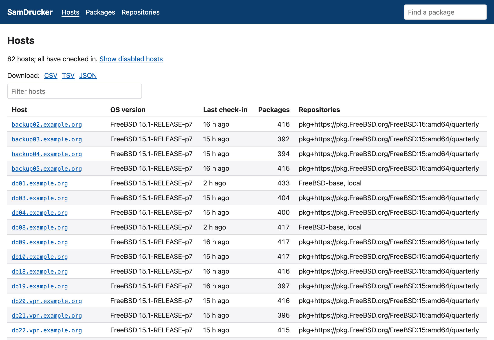
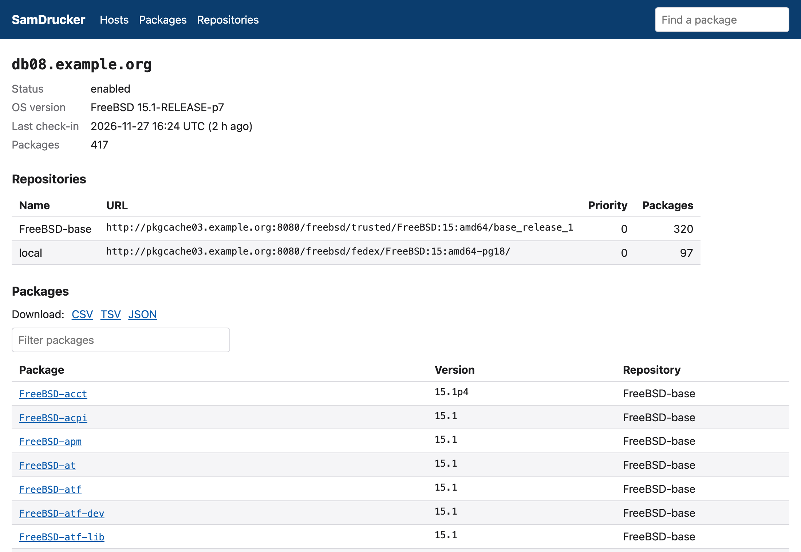
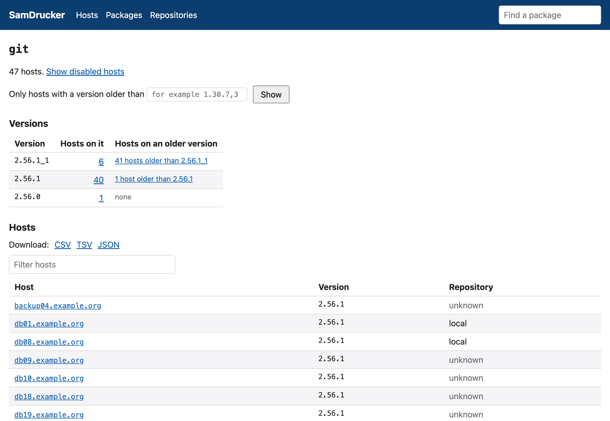
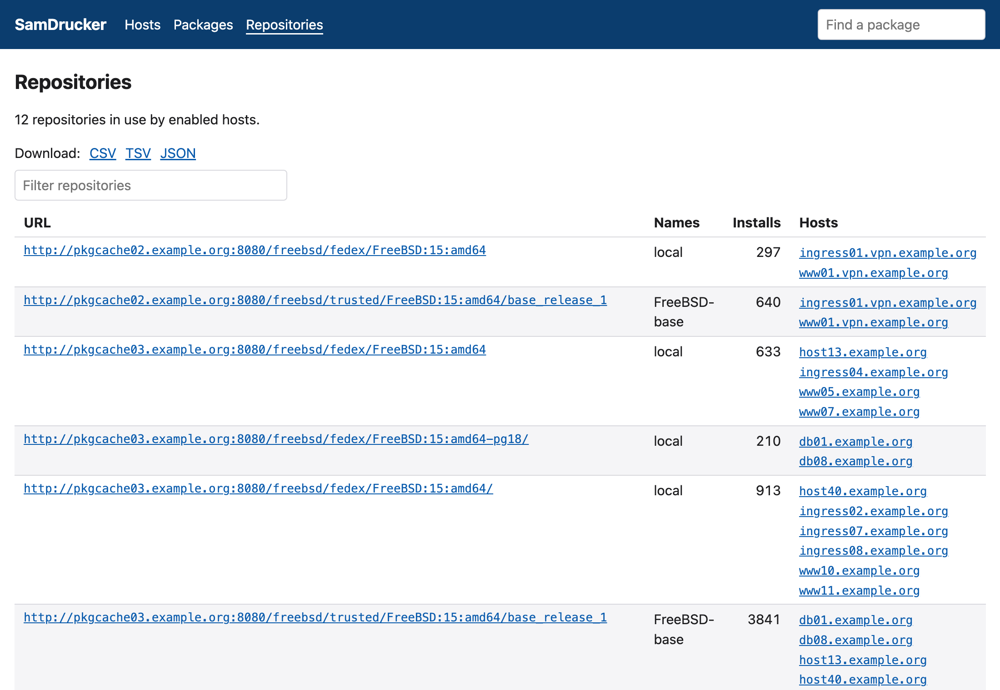
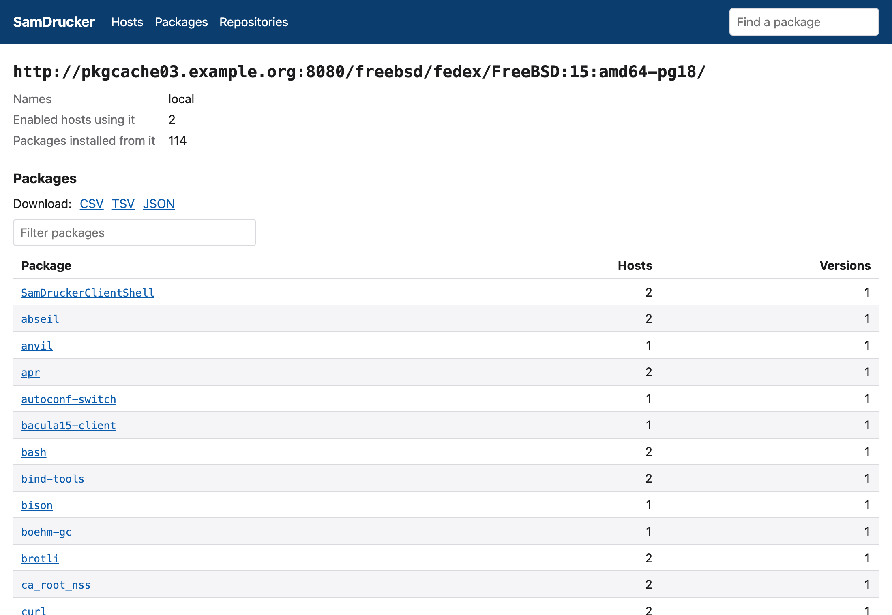

# What is Sam Drucker?

SamDrucker is a collection of small components which create a centralized
list of all packages on all hosts.

Each component is designed to be:

* small
* simple
* easily written
* flexible
* few, if any, dependencies

## The components

* client - collects the list of packages and posts it to the server
* server - accepts the list of packages and adds it to the database
* database - tables and stored procedures for the catalog of packages
* website - a read-only web interface for browsing the catalog (see below)

Each component can be written in whatever languages you want. Collect
the packages in any manner you want. This can be done remotely on the host
or centrally on a management tool, such as Ansible.

Pick whatever languages you want.

## Other ideas

It was mentioned elsewhere that Ansible or Spacewalk can help here. I want
something completely independent. These tools are great at collecting information.

I didn't want to use a large number of dependencies or huge packages.

## Current status

A sample client and web service have been created as proof of concept.
They are deployed in my home network, active on about 90 hosts.

A database schema has been created for PostgreSQL, my database of personal
choice, but this should work on any other database. Patches welcome here.

## The website

A read-only website lets you browse what the hosts have reported: which
hosts check in, what is installed on each, which hosts have a given
package and in which versions, and which repositories the packages came
from. Every table can be sorted, filtered and downloaded as CSV, TSV or
JSON. It is in [servers/php/web](servers/php/web); see its README for
installation.

The host names in these screenshots have been changed.

**Hosts**: every host, when it last checked in, and which repositories it uses.

<picture>
  <source media="(prefers-color-scheme: dark)" srcset="docs/screenshots/hosts-dark.png">
  
</picture>

**One host**: its repositories, and every installed package with the repository it came from.

<picture>
  <source media="(prefers-color-scheme: dark)" srcset="docs/screenshots/host-dark.png">
  
</picture>

**One package**: which hosts have it, how many are on each version, and
which hosts are on a version older than a given one, for example the
version a security advisory says is fixed.

<picture>
  <source media="(prefers-color-scheme: dark)" srcset="docs/screenshots/package-dark.png">
  
</picture>

**Repositories**: every repository in use, and the hosts using it.

<picture>
  <source media="(prefers-color-scheme: dark)" srcset="docs/screenshots/repos-dark.png">
  
</picture>

**One repository**: every package installed from it. Click a package to
see the hosts which installed it from there.

<picture>
  <source media="(prefers-color-scheme: dark)" srcset="docs/screenshots/repo-dark.png">
  
</picture>

Anyone is welcome to help write this stuff.

## Wiki

You can read more in [the wiki](https://github.com/dlangille/SamDrucker/wiki).
